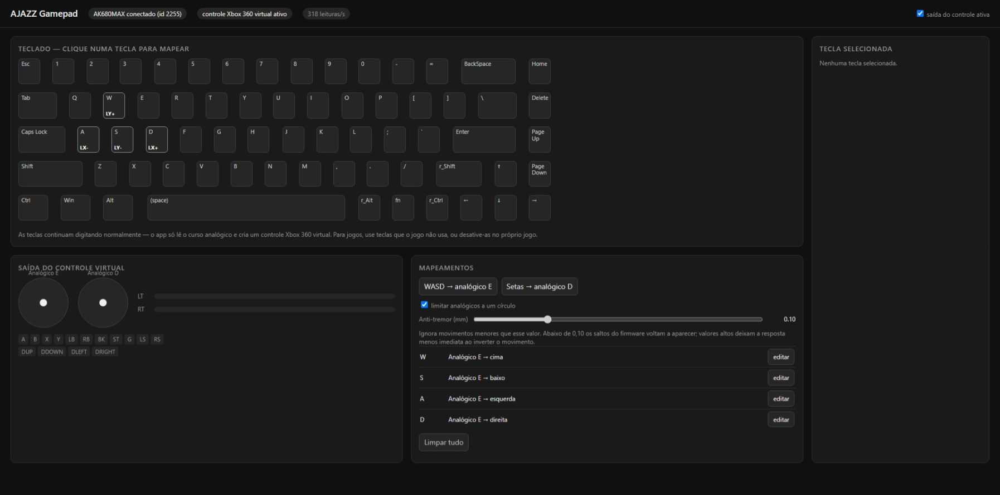

# Keys to Gamepad for AJAZZ Keyboard

Turn the analog travel of your AJAZZ Hall effect keyboard into a **virtual Xbox 360 controller**. Press a key halfway and the stick or trigger moves halfway.

Map any key to the triggers (LT/RT), either analog stick, face buttons, bumpers or D-pad from a local web UI with a live view of every key's travel.

> **Unofficial project.** It is not affiliated with or endorsed by AJAZZ.



## Features

- **Analog output:** map keys to LT/RT and to each stick direction, with an adjustable start point, end point and response curve.
- **Digital output:** map keys to buttons and the D-pad, with an adjustable actuation point and hysteresis.
- **Stick presets:** set up WASD as the left stick or the arrow keys as the right stick in one click.
- **Anti-jitter filter:** ignores small finger movements and the firmware's travel jumps.
- **Live view:** see each key's travel in mm and the virtual controller's output as you press.
- **Read-only access:** the app only reads from the keyboard and never writes to its firmware.

## Compatibility

| Model | Status |
|---|---|
| AJAZZ AK680MAX (VID `3151`, PID `502D`, device ID 2255), wired | Tested |
| Other models | Not supported |

Several models share the same VID and PID, but this app only includes the AK680MAX layout. Wireless modes have not been tested, and the official app also limits live travel readings to wired mode.

## Requirements

- Windows, 64-bit
- [Python 3](https://www.python.org/downloads/) (tested with 3.15; no extra packages needed)
- [ViGEmBus](https://github.com/nefarius/ViGEmBus/releases) installed
- The official **AJAZZ Driver** software, because the app uses its `iot_driver.exe` to talk to the keyboard

## Getting started

1. Download or clone this repository.
2. Close the official AJAZZ Driver window so both apps don't compete for the keyboard.
3. Double-click `run.bat`, or run:

   ```
   python app.py
   ```

4. The UI opens at <http://127.0.0.1:8765/>. Click a key, choose a target, adjust its settings and save.

Windows should now show an Xbox 360 controller, ready for games that support XInput. Your mappings are saved to `profiles/default.json`.

### Finding `iot_driver.exe`

The app starts the driver if it isn't already running, looking in this order:

1. The `--driver` option
2. The `AJAZZ_IOT_DRIVER` environment variable
3. `..\AJAZZ Driver\resources\app\`, relative to this folder
4. `%LOCALAPPDATA%\Programs\AJAZZ Driver\resources\app\`
5. `%ProgramFiles%\AJAZZ Driver\resources\app\`

### Command-line options

| Option | Description | Default |
|---|---|---|
| `--port` | Port for the web UI | `8765` |
| `--driver` | Path to `iot_driver.exe` | Auto-detected |
| `--no-browser` | Don't open the browser on start | Off |

## Settings

| Setting | Applies to | What it does | Default |
|---|---|---|---|
| Start | Analog | Travel where output begins, in mm | 0.2 |
| End | Analog | Travel where output reaches 100%, in mm | 3.0 |
| Curve | Analog | Response shape: 1 is linear, below 1 is more sensitive early on, above 1 gives more precision early on | 1.0 |
| Actuation point | Buttons | Travel where the button is pressed, in mm | 1.2 |
| Hysteresis | Buttons | How far the key must rise before the button releases, in mm | 0.1 |
| Anti-jitter | All | Movement smaller than this is ignored, in mm | 0.12 |

## Troubleshooting

**The stick jitters**
- Keep Anti-jitter above 0.10 mm, the size of the jump the firmware makes when a key changes direction. Higher values respond less immediately when you reverse direction.
- Keep End at around 3.0 mm. Fingers still wobble between about 3.0 and 3.5 mm when holding a key down, and movement past End doesn't reach the output.
- If the on-screen stick is steady but the game shakes, see the note on typing under [Limitations](#limitations).

**"Keyboard not found"**
- Check that the keyboard is connected by cable and that `iot_driver.exe` can be found.

**"Virtual controller unavailable"**
- Check that ViGEmBus is installed. The app keeps retrying, so temporary failures clear on their own.

**Measuring the signal**
- Close the app and run `python tools/capture.py 30 output.csv` to record 30 seconds of raw travel and print noise statistics per key.

## Limitations

- **Mapped keys still type.** The app doesn't block keystrokes, so a game may receive keyboard and controller input at once. Use keys the game doesn't use, or unbind them in the game.
- **One mapping per key** and one saved profile.
- **The web UI is in Brazilian Portuguese.**
- **The virtual controller is created while the app runs** and goes away when it closes.
- **ViGEmBus is no longer actively developed.** It still works, but its future support isn't guaranteed.

## How it works

```
Keyboard  (HID feature reports, vendor interface)
   │
iot_driver.exe  (official AJAZZ helper, gRPC-web on 127.0.0.1:3814)
   │
app.py  reads each key's travel
   │
mapper.py  applies the filter, curves, sticks and button logic
   │
vigem.py → ViGEmClient.dll → virtual Xbox 360 controller
```

### Protocol notes

These were reverse-engineered from the official software and checked against an AK680MAX, so other models may differ.

- **Read travel:** send `E5 FE 01 <page> 00 00 00 <checksum>` as a feature report, then read the reply.
- **Reply format:** each page holds 32 little-endian `uint16` values in hundredths of a millimeter, ordered by the key's position in the matrix. The AK680MAX uses pages 0 to 2.
- **Checksum:** `byte[7] = 0xFF - (sum(byte[0..6]) & 0xFF)`. `iot_driver.exe` calculates it for you.
- **Echo frames:** a read occasionally returns the request itself instead of data. The app detects and discards these frames.
- **Travel behavior:** values saturate at 3.50 mm and jump by about 0.10 mm when a key changes direction.

## Project structure

| Path | Purpose |
|---|---|
| `app.py` | Main loop and local web server (127.0.0.1 only) |
| `ajazz/iot.py` | gRPC-web client for `iot_driver.exe` |
| `ajazz/keyboard.py` | Reads key travel |
| `ajazz/ak680max_layout.json` | Key geometry and matrix positions |
| `ajazz/mapper.py` | Converts travel into controller output |
| `ajazz/vigem.py` | ctypes wrapper for ViGEmClient |
| `web/index.html` | Web UI |
| `tools/capture.py` | Records raw travel and prints noise statistics |
| `vendor/ViGEmClient.dll` | ViGEm client (x64), taken from the [vgamepad](https://github.com/yannbouteiller/vgamepad) 0.1.0 package |

## Credits

- [ViGEmBus and ViGEmClient](https://github.com/nefarius/ViGEmBus) by Nefarius
- [vgamepad](https://github.com/yannbouteiller/vgamepad) by Yann Bouteiller (MIT), the source of the bundled DLL; see `vendor/LICENSE-vgamepad.txt`

## License

[MIT](LICENSE). The bundled ViGEmClient DLL comes from a third-party package; see [Credits](#credits).
